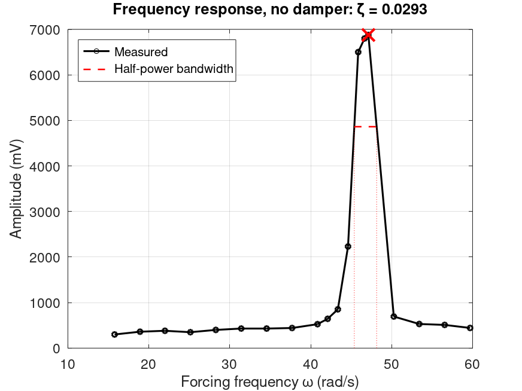
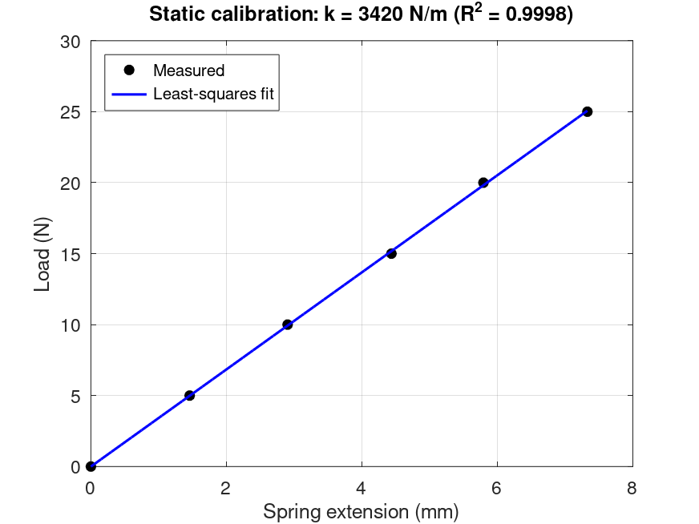
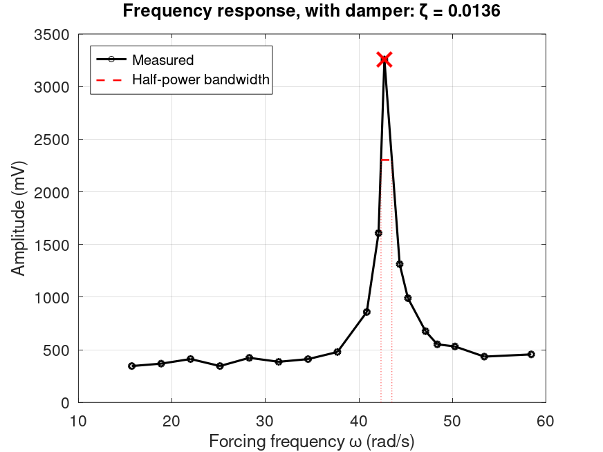
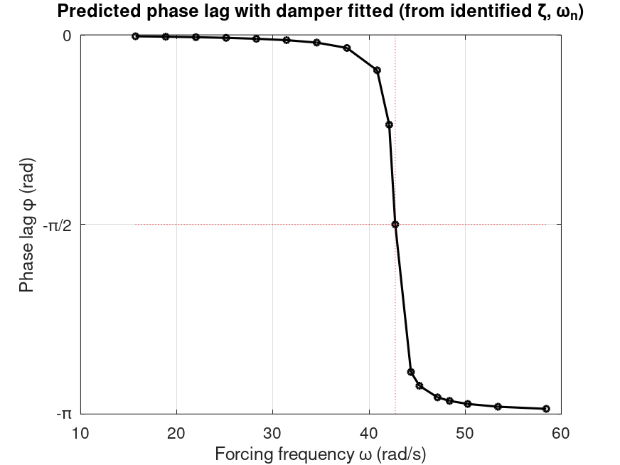

# Mass–damper–spring system identification

[](https://github.com/tariq-98/vibration-system-identification/actions/workflows/tests.yml)

Identifies the physical parameters of a single-degree-of-freedom vibration rig (spring stiffness, natural frequency, effective mass and damping) from four lab experiments. It runs in MATLAB and GNU Octave, and is tested in CI against the original coursework results.

This started as a single coursework script for my BEng at City, University of London (2020). It has since been restructured into small, documented functions with a test suite. The refactor reproduces the original numbers to nine significant figures.



## Results

| Quantity | No damper | Damper fitted |
|---|---:|---:|
| Resonant peak ω (rad/s) | 47.12 | 42.73 |
| Damping ratio ζ | 0.0293 | 0.0136 |
| Effective mass m (kg) | 1.643 | 1.869 |
| Critical damping c<sub>cr</sub> (Ns/m) | 149.73 | 159.68 |
| Damping coefficient c (Ns/m) | 4.389 | 2.177 |

The static tests give:

- **Spring stiffness:** k = 3411 N/m from the endpoint slope, or 3420 N/m from a least-squares fit (R² = 0.9998).
- **Natural frequency** from free vibration: ω<sub>n</sub> = 45.56 rad/s (7.25 Hz).

The damper column reports *less* damping than the undamped column, which is physically backwards. That is a property of the data, not of the code; [Limitations](#limitations) explains why.

## Method

**1. Spring stiffness.** Static loads of 0–25 N are applied and the displacement transducer is read at point B of a pivoted beam. The spring acts at point C, so extension follows from the lever ratio:

$$x_C = \frac{V}{S}\cdot\frac{AC}{AB}, \qquad S = 350\ \text{mV/mm},\ AB = 125\ \text{mm},\ AC = 690\ \text{mm}$$

Stiffness is the slope of load against extension. Hooke's law passes through the origin, so the least-squares fit has no intercept.

**2. Natural frequency.** Five free-vibration periods are averaged: $\omega_n = 2\pi / \bar{T}$.

**3. Damping by the half-power method.** The rig is driven across a frequency sweep. From the resonant peak, the method walks outward on each side until the amplitude drops below $A_{peak}/\sqrt{2}$ (−3 dB). It then interpolates the crossing frequencies ω₁ and ω₂ and computes:

$$\zeta = \frac{\omega_2 - \omega_1}{2\,\omega_{peak}}$$

The original script interpolated over hand-picked index windows for each data set. Walking out from the peak gives the same answer here, needs no indices, and is unaffected by noise away from resonance (there's a test for that).

**4. Mass and damping.** From $\omega_n = \sqrt{k/m}$:

$$m = \frac{k}{\omega_n^2}, \qquad c_{cr} = 2\sqrt{mk}, \qquad c = \zeta\, c_{cr}$$

**5. Phase lag.** The phase of the damped response is predicted from the identified parameters, $\phi = -\operatorname{atan2}(2\zeta r,\ 1 - r^2)$ with $r = \omega/\omega_n$. Using `atan2` replaces the original manual quadrant correction and gives identical values.

<table>
  <tr>
    <td></td>
    <td></td>
  </tr>
  <tr>
    <td colspan="2" align="center"></td>
  </tr>
</table>

## Running it

In MATLAB or Octave, from the repository root:

```matlab
results = run_analysis();                        % print the summary and draw the figures
run_analysis('SaveFigures', true);               % also write PNGs to docs/figures/
addpath('tests'); run_tests                      % run the test suite
```

Headless, as CI runs it:

```bash
octave --no-gui --eval "addpath('tests'); run_tests"
```

## Repository layout

```
run_analysis.m              entry point: load data, identify, report, plot
data/                       raw measurements as CSV, one file per experiment
src/
  rig_constants.m           rig geometry and transducer sensitivity
  load_lab_data.m           CSV loading
  spring_stiffness.m        lever geometry, endpoint and least-squares k
  natural_frequency.m       free-vibration period to rad/s
  half_power_bandwidth.m    half-power (-3 dB) damping estimate
  system_properties.m       mass, critical and actual damping
  phase_lag.m               SDOF phase response
  plot_*.m, print_results.m figures and summary table
tests/run_tests.m           unit tests and regression test
.github/workflows/          CI on GNU Octave
```

The data, the physics and the presentation are kept separate. Every function in `src/` is a pure calculation, apart from the loaders, plots and printer.

## Testing

`tests/run_tests.m` runs nine tests in both MATLAB and Octave:

- **Known-answer tests.** The half-power estimator is run on densely sampled analytic SDOF responses (ζ = 0.01, 0.02, 0.05) and must recover ζ to within 2%. Stiffness must be recovered exactly from synthetic linear data. Phase must pass through −π/2 at resonance.
- **Robustness tests.** Distorting the response away from resonance must not change ζ. A sweep that never drops below half power, or mismatched inputs, must raise a clear error.
- **Regression test.** The whole pipeline must reproduce the results of the original 2020 script, run under Octave 8.4 before the refactor.

## Limitations

Restructuring the analysis made a few things about the data easy to see.

- **The undamped peak looks clipped.** The three highest readings sit on a plateau (6500, 6800, 6876 mV between 7.3 and 7.5 Hz) rather than a sharp peak. That's consistent with the transducer saturating or the response not settling. A flattened peak widens the measured bandwidth, which inflates ζ. It's the most likely reason the undamped ζ comes out higher than the damped one.
- **The damped peak is under-resolved.** Only one sample lies above the half-power line. Both crossings are therefore interpolated across steps of about 0.2 Hz, while the bandwidth itself is about 0.19 Hz. ζ is limited by the sweep resolution.
- **The resonant peak is a sample, not an estimate.** Without the damper it sits at 47.1 rad/s, against 45.6 rad/s from free vibration, a 3% gap that a finer sweep would close.
- **Mass differs between columns** because the damped case takes ω<sub>n</sub> from its own peak, as the original method did.
- **Phase is predicted, not measured.**

**Next steps on the rig:**

- Sweep in steps of 0.02 Hz or less around resonance.
- Check the transducer's range against the peak amplitude.
- Measure phase directly.
- With denser data, fit the full SDOF frequency response by nonlinear least squares as an independent check on the half-power estimate. On the current 18–19 points that fit isn't stable.

## Licence

MIT
